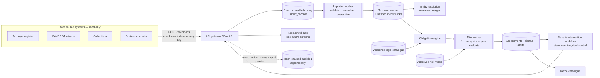
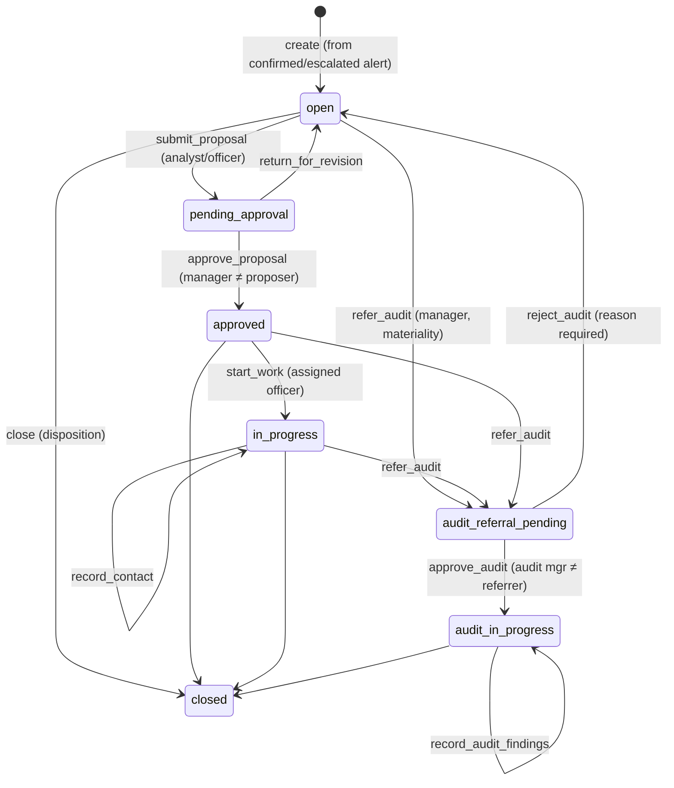

# Architecture (PRD §10)

## Request path and controls
1. **Authentication:** a bearer JWT (`deps.get_principal`). The role and active flag are re-read from
   the database on every request.
2. **Authorisation:** `require(P.…)` checks the role matrix (`permissions.py`) and writes denials to
   the audit log. Rules that depend on who did an earlier step (four-eyes, "cannot approve own") are
   enforced in the domain functions.
3. **Tenant scoping:** `get_scoped` and explicit `tenant_id` filters. The tenant always comes from the
   principal.
4. **Domain change and audit event** happen in the same transaction, then the transaction commits.
5. **Background work:** jobs are enqueued in the same transaction and dispatched after the commit
   (ADR-0003).

## Case workflow

Every transition requires a justification and is written to both `case_actions` and the audit log.
When an alert is suppressed for low confidence, the only interventions that can be proposed are
`correct_data` and `no_action`, and it cannot be referred to audit.

## Signal catalogue (engine `signals-1.0.0`)

| Code | Dimension | Fires when | Safeguards / confidence modifiers | Recommended action |
|---|---|---|---|---|
| REG-001 | registration | Entity in an authorised dataset is unregistered and resident in the state | Jurisdiction check; identity verification required | educational_communication |
| FIL-001 | filing | Obligation past its deadline (incl. extension) with no return | Returns-feed freshness (stale → 0.3), dormant status (→ 0.5), extension | filing_reminder |
| FIL-002 | filing | Return filed after the deadline | — | educational_communication |
| PAY-001 | payment | Allocated payments below declared liability beyond 5 % tolerance | Payments-feed freshness; unallocated or disputed amounts → confidence ≤ 0.4 and `correct_data` | payment_follow_up |
| PAY-002 | payment | Paid in full, but late | — | educational_communication |
| PAY-003 | payment | No return and no payment for an obligation past its deadline | Exposure taken only from the taxpayer's own history | filing_reminder |
| REP-001 | reporting | Reported income > 40 % below the trailing median (≥ 3 months / 1 year of history) | **Hypothesis**; seasonality (same month last year) suppresses it; closure warning | desk_verification |
